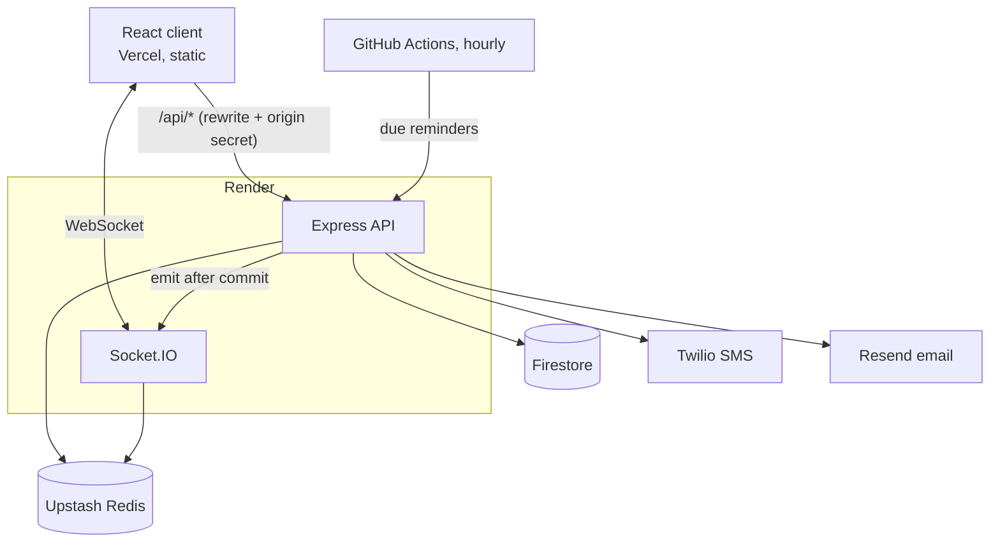

# Skipli — real-time employee task management

An owner signs in with a one-time SMS code, manages employees, assigns tasks on a live kanban board, plans weekly schedules, and chats with the team in real time. Employees onboard from an email link, sign in with a password or a one-time email code, keep their profile up to date, and move their tasks to Done.

**Live app:** https://skipli.vercel.app · API: https://skipli-api.onrender.com (free tier: the first request after a quiet spell can take ~30 s while the server wakes up)

## Try it

Demo mode is on in production, so reviewers can sign in without receiving SMS or email. For the demo accounts below the one-time code is shown on screen instead of being sent.

| Role                  | How to sign in                                                             |
| --------------------- | -------------------------------------------------------------------------- |
| Owner                 | Phone `+1 555 555 0100` → **Send code** → the code appears under the field |
| Employee (password)   | Username `demo.employee`, password `skipli-demo-2026`                      |
| Employee (email code) | Email `demo.employee@example.com` → the code appears under the field       |

To see everything live, open the owner in one browser and the employee in another (or a private window):

- **Tasks:** create a task assigned to Demo Employee; it appears on their board instantly, with a notification. Drag it to Done on their side and the owner's board follows.
- **Chat:** message each other; you'll see presence, typing, and "Seen" receipts.
- **Onboarding:** add an employee. In demo mode the setup link is shown to the owner (no real email needed); open it in a private window to choose a username and password.
- **Schedule:** add shifts (including overnight ones) and watch the employee's read-only view update.
- **Activity:** the feed under the owner's board and the full log on the Activity page update as you go.

## Features

**Required by the challenge**

- Owner sign-in with phone + 6-digit SMS code (`CreateNewAccessCode`, `ValidateAccessCode`); the code is cleared after use.
- Employee management: add (sends a setup email), edit, delete, search; `GetEmployee`, `CreateEmployee`, `DeleteEmployee`.
- Employee onboarding through a secure single-use link; sign-in with username + password or a 6-digit email code (`LoginEmail`, `ValidateAccessCode`).
- Employee profile editing (name, phone, email).
- Tasks assigned by the owner; employees see their own and mark them Done.
- Real-time owner ↔ employee chat over Socket.IO.
- Weekly work schedules.

**Added**

- Realtime kanban (drag and drop, keyboard accessible) with optimistic updates, rollback, and conflict detection when two people edit the same task.
- Due dates with overdue / due-soon badges, hourly reminder job, notification bell, email when the assignee has no tab open.
- Chat between any two coworkers, with presence, "last seen", typing indicators, read receipts, unread counts, retry for failed sends, and catch-up after reconnecting.
- Weekly schedule grid: color per employee, filter, click to add or edit, overnight shifts, overlap checks, all times in the business time zone.
- Activity feed and a paged audit log (sign-ins, failed codes, every change, with names kept after people are deleted).

## Architecture



- **The server is the only thing that touches the database.** Firestore Security Rules deny all client access; the browser talks to the Express API only.
- **One path for every change.** Each mutation goes through `mutate()`: validate (strict Zod schema) → authorize → one Firestore transaction that writes the data _and_ its activity entry → then emit socket events. Clients never hear about a change that rolled back, and no change can skip the audit log.
- **Sockets only notify.** Clients change data over REST and receive updates over Socket.IO rooms (`user:<id>`, `owner`). The one exception is sending a chat message, which goes through the same service layer. After reconnecting, clients refetch what they may have missed.
- **Redis** (Upstash) carries Socket.IO broadcasts between server instances, holds presence, and backs the rate limiters.
- **Same-origin API.** Vercel rewrites `/api/*` to Render and adds a secret header that the server requires. That makes the refresh cookie first-party and lets rate limits trust the client IP Vercel reports.

|           |                                                                                      |
| --------- | ------------------------------------------------------------------------------------ |
| Frontend  | Vite, React 19, TypeScript, React Router, TanStack Query, dnd-kit, Tailwind CSS 4    |
| Backend   | Node 22, Express 5, TypeScript, Socket.IO, Zod, bcrypt, jsonwebtoken, helmet         |
| Data      | Firestore (`firebase-admin`, separate dev and prod projects), Upstash Redis          |
| Messaging | Twilio (SMS), Resend (email)                                                         |
| Hosting   | Vercel (client), Render (API + WebSockets)                                           |
| Quality   | Jest + Supertest against the dev Firestore project, oxlint, Prettier, GitHub Actions |

## Project structure

```
client/src/
  pages/          one file per route (Tasks, Employees, Schedule, Chat, Activity, Profile, Login, Setup)
  features/       auth, tasks, employees, chat, schedule, activity, notifications (hooks + components)
  components/     shared UI (app shell, dialog, notices, class names)
  lib/            API client with token refresh, socket client, types, formatters
server/src/
  routes/         HTTP wiring: route → auth → validation → service (tests sit next to them)
  middleware/     requireAuth, requireRole, validate, rate limits, origin check
  services/       business logic; the only layer that touches Firestore (mutate.ts is the write path)
  schemas/        Zod request schemas, one file per resource
  socket/         connection auth, rooms, chat and presence handlers
  lib/            Firebase, Redis, Twilio, email clients; error type
  scripts/seed.ts creates the owner and demo accounts
firestore.rules         deny-all (clients never access Firestore)
firestore.indexes.json  composite indexes
vercel.json             static client + /api rewrite to Render
render.yaml             API service definition
.github/workflows/      CI and the hourly due-reminder job
```

## Run locally

Requirements: Node 22+, a Firebase project with Firestore, and a Redis URL (a free Upstash database works). Twilio and Resend are optional: without them only demo accounts can sign in, which is enough to try everything.

```bash
git clone https://github.com/vinhpnguyen123/skipli.git && cd skipli
npm install                     # installs client + server workspaces
cp .env.example server/.env     # then fill it in (see below)
npm run seed                    # owner + demo accounts
npm run dev                     # client on :5173, API on :3000
```

Open http://localhost:5173 and sign in with the demo accounts above. Vite proxies `/api` and the socket to the local server.

To create the Firestore indexes in your project: `npx firebase-tools deploy --only firestore --project <your-project-id>` (this also deploys the deny-all rules).

### Environment variables (`server/.env`)

| Variable                                                               | Required           | Purpose                                                              |
| ---------------------------------------------------------------------- | ------------------ | -------------------------------------------------------------------- |
| `FIREBASE_PROJECT_ID`, `FIREBASE_CLIENT_EMAIL`, `FIREBASE_PRIVATE_KEY` | yes                | Service account for `firebase-admin`                                 |
| `JWT_ACCESS_SECRET`                                                    | yes                | Signs 15-minute access tokens                                        |
| `OTP_HMAC_SECRET`                                                      | yes                | Key for hashing one-time codes                                       |
| `REDIS_URL`                                                            | yes                | Socket.IO adapter, presence, rate limits                             |
| `APP_URL`                                                              | yes                | Client origin (CORS, links in emails)                                |
| `DEMO_MODE`                                                            | no                 | `true` shows codes and setup links for demo accounts                 |
| `BUSINESS_TZ`                                                          | no                 | Time zone for schedules and email dates (default `America/New_York`) |
| `TWILIO_ACCOUNT_SID`, `TWILIO_AUTH_TOKEN`, `TWILIO_FROM`               | no                 | SMS codes for the owner                                              |
| `RESEND_API_KEY`, `EMAIL_FROM`                                         | no                 | Invites, email codes, notifications                                  |
| `ORIGIN_SECRET`                                                        | production         | Shared with Vercel; the API rejects `/api` calls without it          |
| `CRON_SECRET`                                                          | production         | Authorizes the hourly reminder job                                   |
| `TRUST_PROXY`                                                          | no                 | Proxy hops in front of the server (Render = 1)                       |
| `SEED_OWNER_PHONE`, `SEED_OWNER_EMAIL`                                 | no                 | Real owner contact used by `npm run seed`                            |
| `VITE_SOCKET_URL`                                                      | client, production | Where the browser opens the WebSocket (unset in dev)                 |

### Scripts

| Command                                                       |                                                                                |
| ------------------------------------------------------------- | ------------------------------------------------------------------------------ |
| `npm run dev`                                                 | client + server with reload                                                    |
| `npm run lint` / `npm run typecheck` / `npm run format:check` | the checks CI runs                                                             |
| `npm run build`                                               | build both workspaces                                                          |
| `npm test`                                                    | server tests (against your Firestore project; Redis, SMS and email are mocked) |
| `npm run seed`                                                | create or reset the owner and demo accounts                                    |

## API summary

Base path `/api`, JSON in and out. Authenticated routes take `Authorization: Bearer <accessToken>`. Errors always look like `{ "error": { "code", "message", "details" } }`.

**Endpoints named by the spec**

| Route                               | Who            | Body → result                                                            |
| ----------------------------------- | -------------- | ------------------------------------------------------------------------ |
| `POST /owner/CreateNewAccessCode`   | public         | `phoneNumber` → SMS code                                                 |
| `POST /owner/ValidateAccessCode`    | public         | `accessCode, phoneNumber` → `{ success, accessToken, user }`             |
| `POST /GetEmployee`                 | owner, or self | `employeeId` → employee                                                  |
| `POST /CreateEmployee`              | owner          | `name, email, department` (+ `phone, title`) → `{ success, employeeId }` |
| `POST /DeleteEmployee`              | owner          | `employeeId` → `{ success }`                                             |
| `POST /employee/LoginEmail`         | public         | `email` → email code                                                     |
| `POST /employee/ValidateAccessCode` | public         | `accessCode, email` → `{ success, accessToken, user }`                   |

**Everything else**

| Area                        | Routes                                                                                                                       |
| --------------------------- | ---------------------------------------------------------------------------------------------------------------------------- |
| Sessions                    | `POST /auth/refresh`, `POST /auth/logout` (refresh cookie)                                                                   |
| Onboarding & password login | `POST /employee/setup/check`, `POST /employee/setup`, `POST /employee/login`, `POST /employee/resend-invite`                 |
| Employees & profile         | `GET /employees`, `PATCH /employees/:id`, `GET /me`, `PATCH /me`                                                             |
| Tasks                       | `GET /tasks`, `POST /tasks`, `PATCH /tasks/:id` (needs `version`; 409 with the latest task on conflict), `DELETE /tasks/:id` |
| Schedules                   | `GET /schedules`, `GET /employees/:id/schedule`, `PUT /employees/:id/schedule`                                               |
| Chat                        | `GET /directory`, `GET /presence`, `GET /conversations`, `GET /conversations/:id/messages`, `POST /conversations/:id/read`   |
| Notifications               | `GET /notifications`, `PATCH /notifications/read`                                                                            |
| Activity                    | `GET /activities?visibility=feed\|audit&cursor=` (owner)                                                                     |
| System                      | `GET /health`, `POST /cron/due-reminders` (cron secret)                                                                      |

**Socket events:** `task:created` / `task:updated` / `task:deleted`, `message:send` (client → server, with ack), `message:new`, `typing:start` / `typing:stop`, `conversation:read`, `presence:update`, `schedule:updated`, `notification:new`, `notification:read`, `activity:new`.

## Design decisions

Where the spec was open, these are the calls I made:

| Question                                                      | Decision                                                                                                                                                                                                                        |
| ------------------------------------------------------------- | ------------------------------------------------------------------------------------------------------------------------------------------------------------------------------------------------------------------------------- |
| The spec says the code endpoints "return" the 6-digit code    | The code is never returned in production. It is returned only in demo mode for demo accounts, so reviewers can sign in without a phone.                                                                                         |
| Two endpoints are both called `ValidateAccessCode`            | Kept both names, under `/owner/…` and `/employee/…`.                                                                                                                                                                            |
| Employee sign-in is described as both password and email code | Both work.                                                                                                                                                                                                                      |
| The owner's phone is "already in the database"                | `npm run seed` creates the owner.                                                                                                                                                                                               |
| The employee form and `CreateEmployee` list different fields  | Accept all of them; phone and title are optional.                                                                                                                                                                               |
| Tasks are in the title but barely specified                   | Full task management with a realtime board, due dates and reminders.                                                                                                                                                            |
| Twilio trial accounts can only text verified numbers          | Demo mode, above.                                                                                                                                                                                                               |
| Who can chat with whom                                        | Any two active users (owner ↔ employee as required, plus employee ↔ employee). Conversations are private to their two participants; the owner can't read employees' chats with each other.                                      |
| What happens to a deleted employee's data                     | Hard delete: account, sign-in tokens, and schedule go; their open tasks become unassigned so the owner can hand them on; chats stay readable for the other person, marked "Former employee"; the activity log keeps their name. |
| Where WebSockets run                                          | Render, after Vercel Functions proved unstable for long-lived sockets. Vercel serves the static client.                                                                                                                         |
| Overnight shifts                                              | Stored as two shifts split at midnight, so the grid and the overlap check stay simple.                                                                                                                                          |

## Security

- **One-time codes** are 6 digits from `crypto.randomInt`, stored only as an HMAC, valid for 5 minutes, compared with `timingSafeEqual`, locked after 5 wrong attempts, and cleared after use. Asking for a code gives the same response whether or not the phone or email exists, so accounts can't be discovered that way.
- **Rate limits** (Redis) apply per IP and per phone/email on every sign-in and code route, and per user on chat messages.
- **Passwords** are hashed with bcrypt (cost 12); 5 wrong passwords lock the account for 15 minutes.
- **Setup links** carry 32 random bytes, are stored as SHA-256, work once, and expire after 48 hours. Resending an invite cancels the old link.
- **Sessions:** a 15-minute access token kept in memory (never in `localStorage`) plus a 7-day refresh token in an httpOnly, Secure, SameSite=Lax cookie, stored hashed and rotated on every use. Presenting an already-rotated refresh token revokes the whole chain (stolen-token detection). The refresh route also requires a custom header, so other sites can't trigger it.
- **Validation and authorization:** every request body is checked with a strict Zod schema (unknown fields are rejected), every route declares who may call it, and resources that belong to someone are ownership-checked. A test walks every protected route to confirm it refuses anonymous callers and, for owner routes, employees.
- **Ownership failures return 404, not 403.** When an employee requests a resource that belongs to someone else, the API answers exactly as if it didn't exist. A 403 would confirm the id is real, letting a caller enumerate other users' ids.
- **Deleting an employee is a hard delete.** The user record, their email/phone reservations, refresh tokens, pending invite links and login codes are removed in one transaction, and their open sockets are disconnected. Every request re-checks that the account still exists, so an access token they still hold stops working right away instead of at its 15-minute expiry. Activity entries keep a copy of the employee's name, so the history still reads correctly after they're gone. The schema also has `status: 'disabled'`, the reversible option: it blocks sign-in and API access but keeps the record. It isn't exposed in the UI yet.
- **The API is only reachable through the app's own domain.** Vercel forwards `/api/*` to the server with a secret header, and the server rejects `/api` requests without it. That keeps the refresh cookie first-party (`SameSite=Lax`, so it works in Safari and other browsers that block third-party cookies) and lets per-IP rate limits use the visitor's real IP from Vercel instead of a spoofable header. API responses are sent with `Cache-Control: no-store` so no CDN caches personal data.
- **Notification emails are best effort.** Assignment and due-date notifications are saved in the same transaction as the change that causes them, so the in-app bell never misses one. The email copy (sent only to people with no open tab) goes out after that commit and isn't retried: if the email provider is down, the email is lost but the notification is not. Guaranteed delivery would need an email outbox written in the same transaction and a job that sends and retries it; that's the planned upgrade if email becomes critical.
- **Secrets** live only in the hosts' environment settings; `.env` files and service-account keys are git-ignored, and the full history has been scanned with gitleaks.

## Testing and CI

The server suite runs with Jest + Supertest against a real Firestore project (`skipli-dev`), with Redis, SMS and email mocked. It covers the security cases (code expiry and lockout, rate limits, setup-link reuse and expiry, refresh-token reuse, role and ownership checks on every route), task version conflicts, chat de-duplication and privacy, presence, schedules and the activity log.

GitHub Actions runs format check, lint, typecheck, build and the tests on every pull request and every push to `main`. Render deploys the API only after that run passes; Vercel deploys the client from `main`.

## Known limitations

- Lists (employees, tasks, schedules) are loaded whole and sorted in memory; fine for a small team, and the code notes where paging would go.
- Shifts are edited with a form, not by dragging on the grid.
- Notification emails are not retried (see Security).
- Render's free tier sleeps when idle, so the first request after a while is slow.
